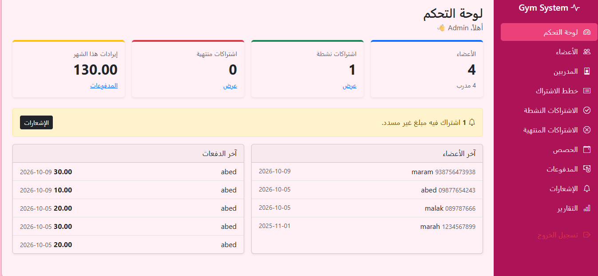
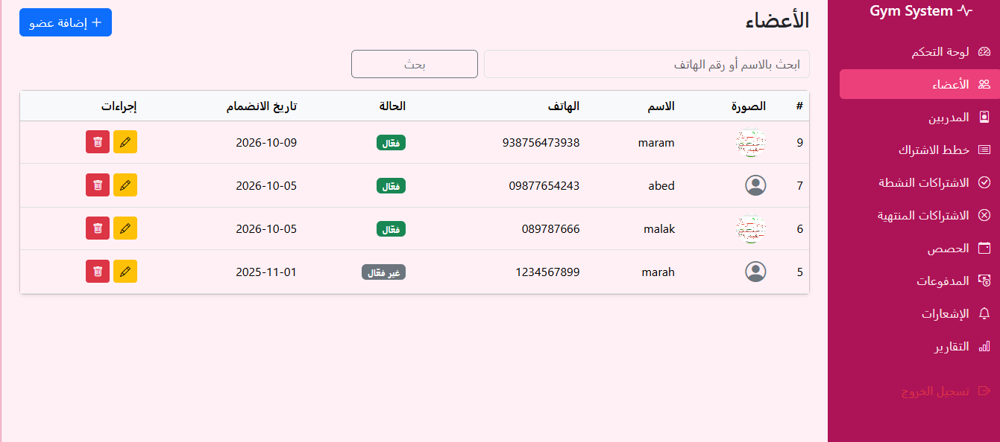

# Gym Management System

نظام متكامل لإدارة صالة رياضية: أعضاء، مدربين، اشتراكات، حصص ومدفوعات — بواجهة عربية RTL متجاوبة.

## التقنيات
PHP 8 (PDO) | MySQL | Bootstrap 5 RTL | JavaScript

## الميزات
- إدارة أعضاء ومدربين مع رفع الصور
- اشتراكات: حساب تاريخ الانتهاء تلقائياً، منع اشتراكين نشطين، تجديد
- مدفوعات: رفض أي دفعة أكبر من المتبقي
- حصص: تسجيل بحدود السعة مع شرط الاشتراك الساري
- لوحة تحكم + إشعارات + تقارير

## الأمان
- كلمات السر مشفرة password_hash
- جميع الاستعلامات Prepared Statements
- حماية XSS
- session_regenerate_id بعد الدخول
- منع تنفيذ PHP بمجلد الرفع

## التشغيل
1. انسخ المشروع إلى C:\wamp64\www
2. شغّل WampServer
3. أنشئ قاعدة gym_management واستورد database/gym.sql
4. افتح http://localhost/gym_management/login.php

## الدخول
admin / admin123 (بيانات تجربة محلية فقط)
## صور من النظام

